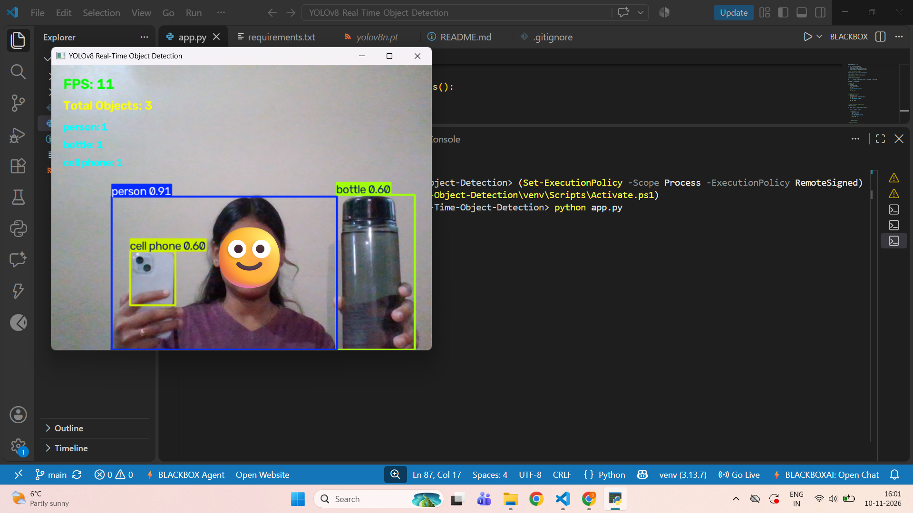

YOLOv8 Real-Time Object Detection System

Project Overview

The YOLOv8 Real-Time Object Detection System is a Python-based computer vision application that detects and identifies multiple objects through a live webcam feed.

The application uses the YOLOv8 pretrained deep learning model and OpenCV to perform real-time object detection, display bounding boxes, identify object categories, calculate confidence scores, and count detected objects.

Features

* Real-time object detection using a webcam.
* Detection of multiple objects.
* Bounding boxes around detected objects.
* Object names and confidence scores.
* Total number of detected objects.
* Individual object counting.
* Real-time FPS counter.

Technologies Used

* Python
* YOLOv8
* OpenCV
* Ultralytics
* NumPy

Project Structure

YOLOv8-Real-Time-Object-Detection/
│
├── app.py
├── requirements.txt
├── README.md
└── .gitignore

Installation and Setup

1. Clone the Repository

git clone YOUR_GITHUB_REPOSITORY_URL

2. Navigate to the Project Folder

cd YOLOv8-Real-Time-Object-Detection

3. Create a Virtual Environment

python -m venv venv

4. Activate the Virtual Environment

Windows PowerShell:

.\venv\Scripts\Activate.ps1

5. Install Dependencies

pip install -r requirements.txt

6. Run the Application

python app.py

The YOLOv8 pretrained model will be downloaded automatically during the first execution if it is not already available.

How It Works

1. OpenCV captures live video from the webcam.
2. YOLOv8 processes each video frame.
3. The model detects and classifies objects.
4. Bounding boxes and confidence scores are displayed.
5. The application counts detected objects.
6. FPS is calculated and displayed in real time.

Output

The application displays detected objects with bounding boxes, object labels, confidence scores, total object count, and FPS.

Model Information

This project uses the pretrained YOLOv8 Nano model (yolov8n.pt) trained on the COCO dataset.

Future Enhancements

* Improve object detection accuracy.
* Add object tracking.
* Develop a graphical user interface.
* Support video file processing.
* Generate object detection reports.

## Project Output

The following screenshot demonstrates the real-time object detection system using YOLOv8 and OpenCV.

Author

Developed as part of the Trainlyze Artificial Intelligence Task 2.